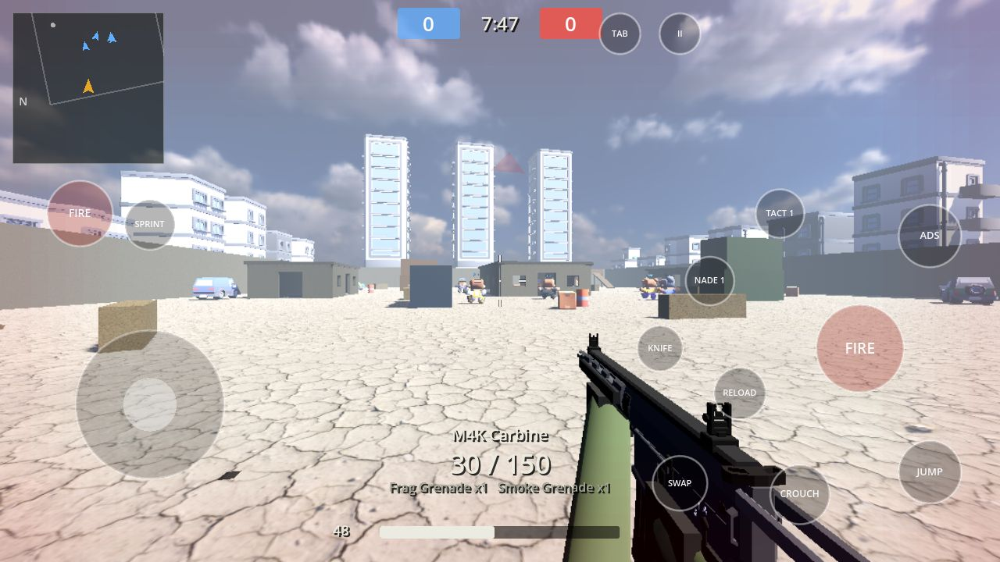
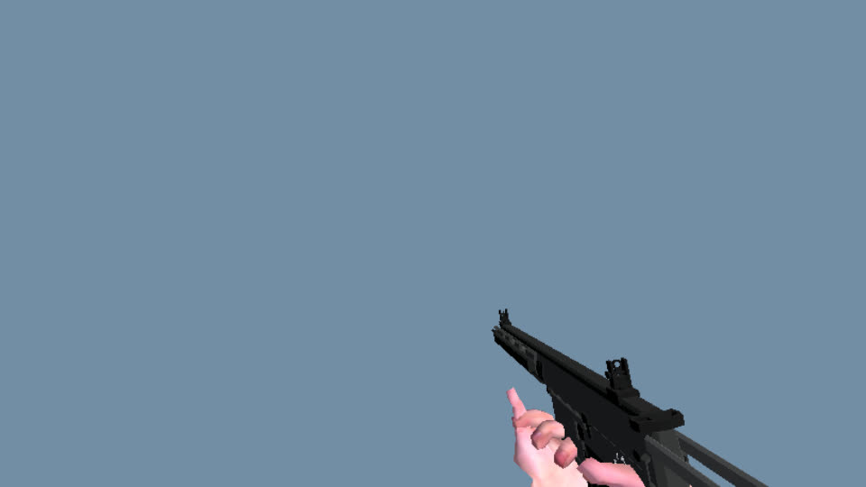
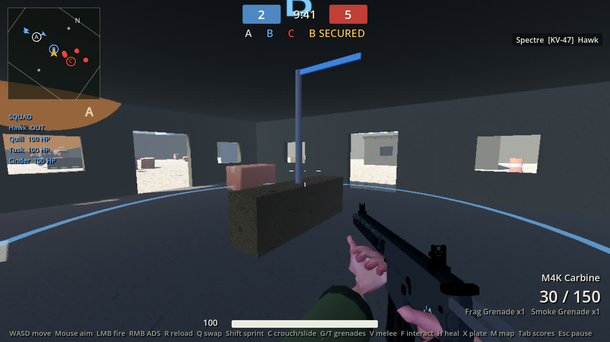
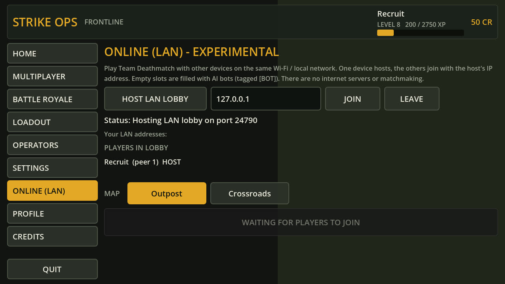
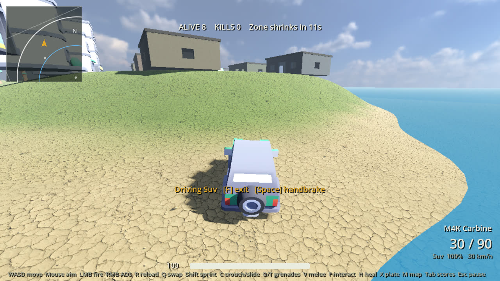
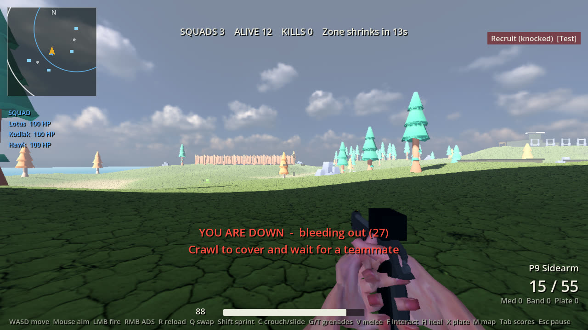

# Strike Ops: Frontline

A mobile-first first-person shooter prototype built with **Godot 4.7.2**. Strike Ops: Frontline brings offline matches against bots, a Battle Royale mode, configurable controls, and a touch-oriented HUD into one playable project.

Third-party assets and their licenses are listed in [ASSET_CREDITS.md](ASSET_CREDITS.md). This is an independent project and is not affiliated with or endorsed by Activision.

> **Engine version note.** The brief asked for Godot **4.7.3**. At the time of writing that version does not exist —
> the latest stable release is [4.7.2-stable (18 Aug 2026)](https://github.com/godotengine/godot/releases).
> The project was built and tested with **Godot 4.7.2-stable**. It uses no 4.7.2-specific features, so a future
> 4.7.3 maintenance release should open it unchanged, but that has **not** been tested.



## Status at a glance

| Area | State |
|---|---|
| Offline Team Deathmatch, Domination, Kill Confirmed, Hardpoint (5v5), Free-For-All and Gun Game (8) vs bots on 5 maps | Playable, tested headless end-to-end |
| Offline Battle Royale (8-20 operators), Solo / Duo / Squad with AI teammates | Playable, tested headless end-to-end |
| Drivable vehicles + pilotable helicopters (BR) | Implemented; car physics and helicopter flight model tested headless |
| LAN Team Deathmatch (2+ humans + bots) | Implemented; tested with **two processes on one machine** (localhost), not across real devices |
| Touch controls + HUD editor | Implemented; multi-touch verified with injected touch events (not on a physical phone) |
| Keyboard/mouse | Implemented; used for desktop play |
| Gamepad | Basic bindings exist; not tested with real hardware |
| Internet multiplayer | **Not implemented.** No servers, matchmaking or accounts; LAN only |
| Android build | Export preset included; **APK not built or tested** (no Android SDK/JDK in the build environment) |

## Getting started

1. Install Godot 4.7.x (standard build, not .NET) from https://godotengine.org/download.
2. Clone: `git clone https://github.com/jazsajonia-pixel/codcopy.git`
3. Open Godot, **Import** `codcopy/project.godot`. The first import takes a minute (GLB/texture import).
4. Press **F5**. The main scene is `res://scenes/menus/main_menu.tscn`.

Renderer: Mobile (Vulkan). On machines without Vulkan, run with `--rendering-driver opengl3`.

## Controls

Settings > Controls > **Control scheme**: Auto (default), Touch or Keyboard/Mouse. Auto starts with touch controls
when the device reports a touchscreen and then switches live: touching the screen shows the on-screen controls,
pressing a keyboard key or gamepad button switches to keyboard/mouse (click the game window to lock the mouse for
aiming).

**If you can't move / there are no on-screen controls:**
1. Check the build shown on the main menu's HOME page (e.g. `Build 0.6.0 (2026-10-11)`). If it is older or missing,
   your copy is out of date. In the **Godot Android editor**: download the repo again (GitHub > Code > Download ZIP),
   extract it, import/open that folder in the Project Manager, let it finish importing, then press Play.
2. If something fails at runtime, a red **ERRORS** box appears in the top-left with the message and script line
   (Godot 4.5+). Take a screenshot of it; tap it to hide it.
3. On phones/tablets touching the screen always brings up the on-screen controls. On a PC, click inside the game
   window so it has keyboard focus. In Battle Royale press JUMP / Space to leave the aircraft first.

### Touch (default on touchscreen devices)
- **Left side**: floating movement joystick with an adjustable deadzone; the base follows your thumb if you drag past
  its edge. Push fully forward to auto-sprint; drag past the top to lock sprint.
- **Right side**: drag anywhere empty to look (aim acceleration curve, jitter smoothing and a separate vertical speed,
  all adjustable). Dragging on **FIRE** or **ADS** also aims (fire-and-steer).
- Buttons: FIRE (right, plus optional left FIRE), ADS, JUMP, CROUCH (tap while sprinting to slide), RELOAD,
  FRAG (lethal), TACT (tactical), PICK/OPEN (appears near loot), SPRINT, HEAL / PLATE / BAG / VIEW (BR only), TAB (scoreboard), II (pause).
- **Weapon bar** (bottom centre, CODM style): in Battle Royale it shows weapon 1, weapon 2 and fists/knife - tap a card
  to equip it. In Multiplayer it shows your one gun (tap to draw it, tap again to inspect) and your melee weapon
  (tap = knife out / swing). The old SWAP and KNIFE buttons are hidden by default and can be turned back on in the HUD editor.
- While aiming down sights every button except FIRE and ADS fades out (and the weapon bar dims), so the sight is clear.
- During the BR drop JUMP becomes **CHUTE** (open the parachute) and **CUT** (close it again while high enough).
- The interact button changes with context: PICK / OPEN near loot, DRIVE / RIDE near a vehicle, REVIVE (hold) near a downed teammate.
- **Driving**: the joystick steers and accelerates, drag the right side to orbit the chase camera, BRAKE = handbrake,
  EXIT gets out. **Flying** a helicopter: the joystick tilts it, UP / DOWN climb and descend, and it turns to face
  where you look. Weapon buttons are hidden while driving.
- Each finger is owned by exactly one control, so pressing a button never rotates the camera, and fire + move + look work simultaneously.
- Layout respects the device safe area (notches/cut-outs).
- **HUD editor** (Lobby > HUD LAYOUT, or Settings > Controls): drag to move, slider to resize, opacity, show/hide per button, Reset, Save. Saved to `user://settings.cfg`.

### Keyboard & mouse
| Action | Key | Action | Key |
|---|---|---|---|
| Move | WASD / arrows | Fire / ADS | LMB / RMB |
| Jump | Space | Crouch / slide | C or Ctrl |
| Sprint | Shift | Reload | R |
| Swap weapon | Q | Weapon slot 1 / 2 / fists (BR) or knife (MP) | 1 / 2 / 3 |
| Frag / tactical | G / T | First / third person (BR) | Z |
| Backpack (BR) | I or B | Open / close parachute | Space (while dropping) |
| Melee | V | Interact / loot | F or E |
| Heal / armor plate | H / X | Full map | M |
| Scoreboard | Tab (hold) | Pause | Esc / P |
| Enter / exit vehicle | F or E | Handbrake | Space (while driving) |
| Revive teammate | hold F or E | | |

Click the game window to capture the mouse.

## Features

### Front end (CODM-style lobby)
- **Lobby**: top bar with avatar, name, level and XP, MULTIPLAYER / BATTLE ROYALE tabs, credits and settings; the
  operator on a lit stage in the middle; season / daily missions / career cards on the left; a mode card ("TEAM
  DEATHMATCH - Outpost", tap to change) and a big gold **START** button on the right; a bottom bar with Loadout,
  Operators, Online, Career, HUD Layout and Credits. Dark slate panels, gold accent and slanted buttons throughout.
- Multiplayer select (mode cards, map cards, bot difficulty; remembered for the lobby START), Battle Royale select (Solo / Duo / Squad, lobby size, difficulty),
  Online (LAN) page (host, join by IP, player list, map, START LAN TEAM DEATHMATCH).
- **Loadout editor**: 3 saved loadouts; Multiplayer follows the CODM rule of **one primary gun + melee** (plus lethal
  and tactical; no secondary - Battle Royale weapons come from loot); a rotating 3D weapon preview; per-weapon attachments
  (optic, muzzle, barrel, grip, magazine, stock) and skins; stat bars with +/- comparison to the previous choice.
- **Operators**: 33 chibi operators with 3D preview, unlocked by level: 12 Kenney Mini Characters, 18 Kenney Blocky
  Characters and 3 Quaternius Toon Shooter soldiers (Sentinel, Hazard, Crimson). One `ActorModel` drives all three
  rigs (skinned, node-animated and Mixamo-like) with height normalisation, clip mapping, aim pitch, melee swings,
  hit flinches and physics-driven death falls.
- **Settings** (only settings that actually affect the game are shown): control scheme, sprint mode, ADS tap/hold,
  invert Y, aim assist (touch), simple-mode auto-fire, gyroscope (mobile only), camera / mouse / ADS / per-optic sensitivity,
  vertical look speed, aim acceleration, look smoothing, joystick deadzone,
  master / music / effects volume, graphics preset, render scale, shadows, effects quality, MSAA, FPS cap, FOV, FPS counter,
  enemy highlight color, hit marker size, camera shake, touch button size & opacity.
- Loading screen (tips; the match scene is loaded synchronously after the screen is drawn), results screen (outcome, K/D/A, score, headshots, accuracy, XP, credits,
  level-ups, full scoreboard with bots labelled `[BOT]`), pause menu (resume, restart, sensitivity, quit).
- Progression: XP per kill/assist/score/win, levels up to 50, unlocks for weapons, attachments, operators and skins.
  Everything persists in `user://profile.json`. There are **no paid items**; credits are only a play reward.

### Gunplay
- 23 data-driven weapons (`resources/weapons/*.tres`): 3 ARs (incl. the Ironclad 3-round burst), 4 SMGs, LMG,
  4 shotguns, 3 snipers (incl. two anti-materiel rifles), DMR, 4 pistols (incl. a magnum), and 2 launchers (Viper
  rocket launcher, Thumper grenade launcher - BR loot only) firing real projectiles with gravity, bounces and splash.
  Each defines damage, headshot multiplier, pellets, range/falloff, RPM, fire mode (auto / semi / burst / pump / bolt),
  magazine, reserve, reload (tactical/empty), ADS time and FOV, hip/ADS/move spread, bloom, recoil and recovery, mobility.
- Hitscan with spread cone, damage falloff, headshots, wall penetration blocked, tracers, impacts, muzzle flash,
  hit markers (headshot/kill variants), damage direction indicators, kill feed, kill streak callouts.
- **Floating damage numbers** over the target (white = health, blue = armor, yellow = headshot; rapid hits add up).
  Can be turned off in Settings > Controls.
- **Accurate crosshair**: the crosshair gap is the exact bullet cone (spread + bloom + movement, slide, jump and
  crouch modifiers), so shots always land inside it. Optics show their own reticle while aiming.
- **Slide vs crouch** (CODM rule): crouch while you have been sprinting for a moment = slide; crouch while walking,
  standing, or just after getting up = crouch.
- 15 attachments with real stat modifiers; suppressors hide you from the enemy radar.
- Frag, sticky charge, smoke (blocks bot vision), flash (blinds player and bots); melee knife/hatchet/baton.
- First-person view model with bob, sway, recoil kick, reload and switch animations, optic models, skin tint,
  ejected shell casings, muzzle smoke, a **weapon inspect** animation (Y key / D-pad left / tap the active gun card)
  and visible melee weapons with slash animations.
- **Magnified scopes** (fixed: the 4x/8x view used to be covered by a black disc - the scope tube model sat in front of
  the camera). Sniper and ACOG scopes now render a proper scope overlay with mil-dots / chevrons, scope-in fade,
  breathing sway and lens edge; a 3x optic was added.
- **Effects**: pooled GPU particle bursts for blood, dust, sparks, debris and chunks, fire and smoke; big explosions
  with shockwave rings, scorch decals and debris; landing dust; rotor wash.
- **Physics**: bullets and explosions push physics props (explosive barrels, gas tanks, crates, boxes, pallets) that
  can be shot and blown up; explosion knockback on players and bots; hit flinches; ragdoll-like death falls in the
  direction of the killing hit.
- **First-person arms**: rigged CC0 arms ([WRAD Arms](https://github.com/wwwriks/wrad-arms)) posed with two-bone IK
  onto each gun's grip, trigger and support points. The support hand follows the magazine on reloads, works the pump
  or bolt between shots, and there are poses for throwing, healing / plating, knife jabs and unarmed punches.
  Pale or dark skin can be chosen in Settings > Graphics, and the sleeves are tinted to match the operator.



### Multiplayer (offline vs bots)
- **Team Deathmatch** (5v5, first to 40 or 8 minutes), **Domination** (5v5, flags A/B/C, first to 100),
  **Free-For-All** (8 players, first to 20), **Kill Confirmed** (5v5, kills drop dog tags: grab enemy tags to score,
  friendly tags to deny; first to 50), **Hardpoint** (5v5, one zone that moves every 60 s, a point per second while
  held alone; first to 150) and **Gun Game** (8 players, every kill swaps you to the next of 14 weapons; a knife kill
  sets the victim back a tier).
- **Kill feedback**: CODM-style hex medals (Double/Triple/Fury kill, Headshot, Longshot, First Blood, Point Blank,
  kill streaks), "+score" popups and an ELIMINATED banner.
- Domination: stand in a flag's ring to capture it (faster with more teammates, frozen while contested); each held
  flag scores a point every 2 s. Bots push flags their team doesn't own and defend otherwise. Flag strip on the HUD
  and flags on the minimap.
- **UAV scorestreak**: 3 kills without dying reveals the enemy team on the minimap for 20 s (bots get it too).
- Maps: **Outpost** (desert compound), **Crossroads** (urban intersection), **Dockyard** (container port with a
  walkable crane deck and a warehouse), **Suburbia** (small two-house cul-de-sac for non-stop close fights) and
  **Firebase** (military camp with trenches, bunkers and a rooftop helipad), built procedurally from Kenney and
  Quaternius kits.
- Pre-match countdown, spawn selection away from enemies, 3.5 s respawn, spawn protection, radar pings when firing unsuppressed.



### LAN Team Deathmatch (experimental)
- One device hosts (**Online (LAN) > HOST LAN LOBBY**); others enter the host's IP and **JOIN** (port 24680, same Wi-Fi/LAN).
- The host picks Outpost or Crossroads and presses **START**. Every device loads the same map; teams alternate by join
  order and empty slots are filled with AI bots simulated on the host. Bots are always tagged `[BOT]`; humans show their
  profile name.
- How it works: each device simulates only its own player and sends its state 20 times per second; the host simulates
  the bots and relays everyone's state; other players are interpolated "puppets". The **host is authoritative** for
  health, deaths, kills, scores, respawns, the timer and the end of the match. Clients report their hits to the host,
  which checks them (sender owns the attacker, plausible distance/damage, rate limit) before applying damage.
- Shots and explosions are replayed as effects for everyone. If a player leaves, their puppet is removed; if the
  host leaves, clients get a "host disconnected" result and return to the menu. The pause menu doesn't stop a LAN match.
- Not provided: internet play, NAT traversal, dedicated servers, lag compensation, client-side damage prediction or
  anti-cheat. On high-latency networks shots can register late.



### Battle Royale (offline vs bots)
- **Isla Verde**: expanded to about 560 m (1.6x) with terrain, a central ridge, dirt roads and nine POIs (Harbor
  Town, Depot, Farmstead, Radar Hill, Crossing, Pine Ridge, plus the new **Airfield** with runway, hangars and two
  helipads, **Military Base** with walls, barracks and watchtowers, and **Fishing Village** with a pier). The safe zone
  starts larger and has an extra phase.
- **Third-person view** (default in BR, like CODM's BR TPP; Multiplayer is always first person). Over-the-shoulder
  camera that pulls in when a wall is behind you; aiming down sights switches to the first-person sight; the VIEW
  button / Z key (or Settings > Controls > Battle Royale view) switches between first and third person.
- **Drop**: boarding countdown, then a higher (240 m) aircraft. The drop is now physics-based (`DropPhysics`: gravity
  plus quadratic drag towards terminal speeds). After jumping you fly a **wingsuit**: push forward to glide (about
  30 m/s forward, 13 m/s down), look down to dive (up to 52 m/s down). The **parachute** is clearly slower: it
  inflates over about a second with an opening shock, then sinks at about 4 m/s (2.6 m/s when flaring) and drifts
  forward at 8 m/s. Landing kicks up dust. The parachute opens
  by itself at 45 m or earlier with CHUTE/Space, can be closed again with CUT/Space above 28 m, and you can fire from
  the hip under the canopy. The camera pulls back while dropping, and the HUD shows altitude and speed. Bots use the
  same wingsuit and parachute.
- Ground loot (weapons + matching ammo, armor tiers 1-3, medkits, bandages, armor plates, grenades), supply crates at POIs, death boxes.
- 2-weapon inventory plus fists, shared ammo pools, health + armor, timed healing/plating.
- **Auto loot** (on by default, Settings > Controls): walking over a weapon puts it in an empty slot without taking
  the gun out of your hands, and better armor is put on automatically. Ammo, heals, plates and grenades are always
  auto-collected. Items you drop are not picked straight back up.
- **Backpack** (BAG button / I key): your weapons with their attachments (EQUIP / DROP), armor (DROP), ammo per type
  (DROP), med kits, bandages and plates (USE / DROP) and grenades (DROP). The match keeps running while it is open.
- 5-phase shrinking safe zone with escalating damage, next-circle preview on minimap and full map (M).
- Alive counter, kill feed, placement, victory when last alive (or last squad standing).
- **Squads**: Solo, Duo or Squad (4). Your teammates are AI bots labelled `[BOT]`. In duos/squads a lethal hit knocks
  you **down** instead of killing you while a squadmate is still standing: you crawl, can't use weapons, and bleed out
  in 30 s. A teammate revives you by holding interact for 4 s. If the whole squad is down, the squad is eliminated.
  AI teammates jump with you, follow you, revive you and each other, and ride along as passengers when you drive.
  After you are eliminated you spectate a living teammate. HUD squad panel shows each teammate's health / DOWNED / OUT.
- **Vehicles**: 12 drivable vehicles on Isla Verde (SUV, sedan, pickup truck, patrol cruiser, van; Kenney Car Kit
  models) with real suspension physics, seats for passengers, a chase camera, an engine sound, health, smoke when
  damaged, and an explosion when destroyed (occupants are thrown out and take damage). Running over enemies hurts
  them; teammates and empty rolling cars don't. Bullets and explosions damage vehicles and pass part of the damage
  to the people inside. Vehicles show on the minimap. Bots don't drive (they only ride with you).

- **Helicopters** (Airfield and Military Base): 4 seats (pilot + 3 passengers). Rigid-body flight model: rotor RPM
  spins up when the pilot boards, collective (UP / DOWN buttons, Space / C) sets the climb rate and hands-off holds
  altitude, the stick tilts the airframe so the rotor thrust pulls it forward or sideways, the nose follows your camera,
  quadratic air drag, a ground cushion for landings, crash damage from hard impacts, rotor wash dust, and the usual
  vehicle damage / explosion. The HUD shows altitude and rotor RPM.




### Bots
- States: patrol, investigate (hearing unsuppressed gunfire), engage, retreat to cover, heal, loot (BR), move to zone (BR), parachute (BR).
- Perception uses FOV cone + line of sight + view distance; smoke blocks vision; flashbangs blind them.
- Difficulty (easy / normal / hard) changes reaction time, aim error, FOV, view distance, burst length and aggression.
- Bots obey the same rules as the player: limited ammo and reloads, weapon spread/recoil, no wall-hacks.
- `NavigationRegion3D` navmesh baked at match start; `NavigationAgent3D` path following.

## Project layout

```
project.godot              Godot project (main scene: scenes/menus/main_menu.tscn)
export_presets.cfg         Android (arm64-v8a) export preset
scenes/                    Thin .tscn wrappers (menus, matches, maps, player, bot, HUD)
scripts/autoload/          SaveManager, GameDB, AudioManager, MatchConfig, Effects
scripts/player/            Player controller, input state, first-person view model and IK arms
scripts/ai/                Bot AI
scripts/combat/            Actor base class (health/armor/weapons), hitscan/melee/explosions
scripts/weapons/           WeaponData resource, WeaponInstance runtime, grenades
scripts/inventory/         Inventory (MP loadouts and BR pickups)
scripts/maps/              MapBuilder + Outpost, Crossroads, Isla Verde
scripts/multiplayer/       MatchBase, TDM/DOM/FFA rules and match, Domination flags,
                           NetworkManager (LAN lobby), NetSync (LAN match replication)
scripts/battle_royale/     BR match (solo/duo/squad), safe zone, loot, supply crates
scripts/vehicles/          Drivable vehicles (VehicleBody3D)
scripts/ui/                Menus, pages, HUD, touch controls, minimap, HUD editor
resources/weapons/         Weapon definitions (.tres) - edit these to tune gunplay
tests/                     Automated tests and screenshot helper
docs/                      Architecture notes, test report, screenshots
```

See [docs/ARCHITECTURE.md](docs/ARCHITECTURE.md) for how the systems fit together.

## Running the tests

```bash
godot --headless -s res://tests/check_scripts.gd                       # parse/load every script & scene
godot --headless --fixed-fps 60 res://tests/test_runner.tscn -- unit    # 81 unit tests (incl. drop physics, new modes/maps/operators)
godot --headless --fixed-fps 60 res://tests/test_runner.tscn -- menus   # menu pages, loadout, LAN host, HUD editor
godot --headless --fixed-fps 60 res://tests/test_runner.tscn -- tdm     # full TDM match, player driven by autopilot
godot --headless --fixed-fps 60 res://tests/test_runner.tscn -- ffa
godot --headless --fixed-fps 60 res://tests/test_runner.tscn -- kc      # Kill Confirmed on Dockyard
godot --headless --fixed-fps 60 res://tests/test_runner.tscn -- hp      # Hardpoint on Firebase
godot --headless --fixed-fps 60 res://tests/test_runner.tscn -- gun     # Gun Game on Suburbia
godot --headless --fixed-fps 60 res://tests/heli_test.tscn              # helicopter flight model (climb, hover, cyclic, yaw, landing)
godot --headless --fixed-fps 60 res://tests/test_runner.tscn -- br      # full BR match (shortened timings)
godot --headless --fixed-fps 60 res://tests/test_runner.tscn -- touch   # injected multi-touch input checks
godot --headless --fixed-fps 60 res://tests/test_runner.tscn -- flow    # menu -> loading screen -> match with touch HUD (MP + BR + driving)
godot --headless --fixed-fps 60 res://tests/test_runner.tscn -- vehicle # vehicle physics, enter/exit, damage, run-over
godot --headless --fixed-fps 60 res://tests/test_runner.tscn -- squad   # BR squads: knock-down, revive, wipe, spectate
godot --headless --fixed-fps 60 res://tests/test_runner.tscn -- br_squad # full autoplayed squad BR match
godot --headless --fixed-fps 60 res://tests/test_runner.tscn -- dom     # Domination + UAV
godot --headless --fixed-fps 60 res://tests/test_runner.tscn -- moves   # slide vs crouch rules, crosshair = bullet cone
godot --headless --fixed-fps 60 res://tests/test_runner.tscn -- brfeat  # TPP camera, weapon bar, auto loot, backpack, wingsuit/parachute, damage numbers
godot --headless --fixed-fps 60 res://tests/test_runner.tscn -- keys    # real keyboard/mouse events (also run under xvfb)
tests/run_net_test.sh                                                  # LAN TDM: host + client processes on localhost
```
Run them one at a time (they share the `user://test_tmp` folder). Exit code 0 means pass. The LAN test runs in real
time (about 2 minutes) and compares the final scores seen by the host and the client.
Results of the last run are in [docs/TEST_REPORT.md](docs/TEST_REPORT.md).

## Android export (not yet verified)

The repo includes an Android preset (`export_presets.cfg`: arm64-v8a, landscape sensor orientation, immersive mode,
INTERNET + ACCESS_NETWORK_STATE permissions for LAN play). To build an APK:

1. Install **JDK 17** and the **Android SDK** (platform-tools, build-tools, an API 34+ platform), e.g. via Android Studio.
2. In Godot: **Editor > Editor Settings > Export > Android**, set the Java SDK path and Android SDK path.
3. **Editor > Manage Export Templates > Download and Install** (templates matching your Godot version).
4. Debug builds use Godot's auto-generated debug keystore. For release, create a keystore with `keytool` and fill
   *Keystore > Release* in the preset (keep `export_credentials.cfg` out of git — it is already ignored).
5. **Project > Export > Android > Export Project**, or from the command line:
   `godot --headless --export-debug "Android" build/StrikeOps-debug.apk`
6. Install with `adb install build/StrikeOps-debug.apk`.

In the authoring environment, step 5 fails with "A valid Java SDK path is required" because no JDK/SDK was installed,
so **no APK has been produced and the game has not been run on an Android device**. Expect to tune render scale,
bot count and BR lobby size for lower-end phones.

## Known limitations

- **No internet play.** LAN Team Deathmatch only (same local network, host's IP typed in). There are no servers,
  accounts or matchmaking. LAN play was tested with two game processes on one machine, **not** between separate
  phones/PCs; Wi-Fi latency, packet loss and firewalls were not tested. Only TDM is networked (not Domination, FFA or BR).
- LAN has no lag compensation or anti-cheat; the host's validation only rejects implausible hit reports.
- Not tested on physical Android/iOS hardware; touch input was verified with synthetic events only.
- Low-poly CC0 art; arms have no hand-animated clips (poses are procedural IK), simple aircraft/parachute meshes.
- Operator bodies use the character kit's own clips (idle, walk, sprint, crouch, fall, die, holding/shooting poses)
  blended in an AnimationTree, plus a procedural aim-pitch pose. There are no reload or weapon-specific third-person
  animations, and downed operators are shown by tilting the model (no crawl animation). The wingsuit is simple
  box-shaped membranes.
- Weapon icons on the weapon bar / backpack are rendered from the 3D gun models at runtime (no hand-drawn icons).
- Bots never drive vehicles; there are no boats or helicopters. Vehicle handling is arcade-simple.
- One scorestreak (UAV) only; no ranked mode, no Hardpoint/Search & Destroy.
- Bot tactics are basic (simple cover selection, no squad tactics beyond follow / revive). Bots can occasionally get stuck on geometry.
- Gamepad bindings exist but were not tested with hardware.

## Next steps

1. Build and profile on real Android devices (low/medium/high presets), then tune draw distance and bot counts.
2. Test LAN play between real devices on Wi-Fi; add lag compensation and network Domination/FFA.
3. Hand-authored arm animations and weapon-specific third-person poses (reload in TPP); crawl animation for downed operators.
4. Bots that drive, more maps and modes (Hardpoint), more scorestreaks.
5. Squad ping markers, attachment swapping inside the backpack, BR classes / airdrops.
